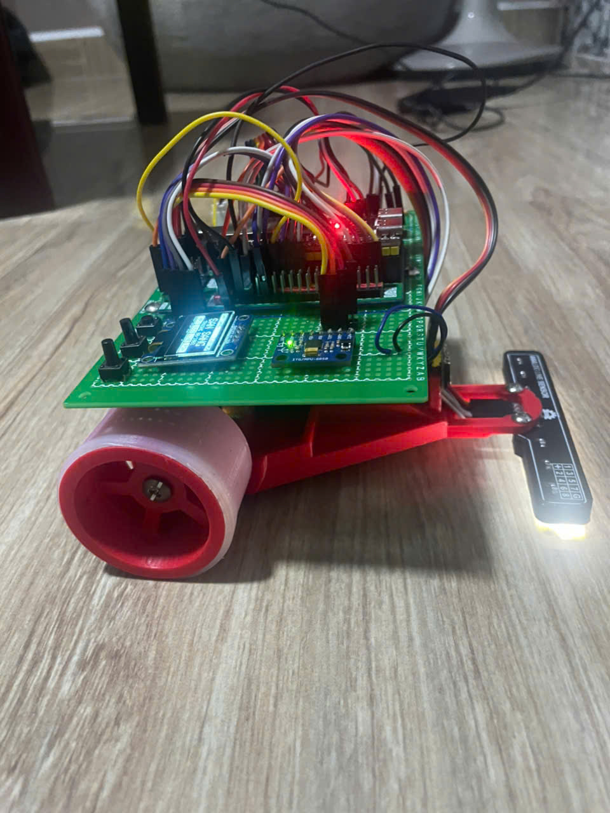
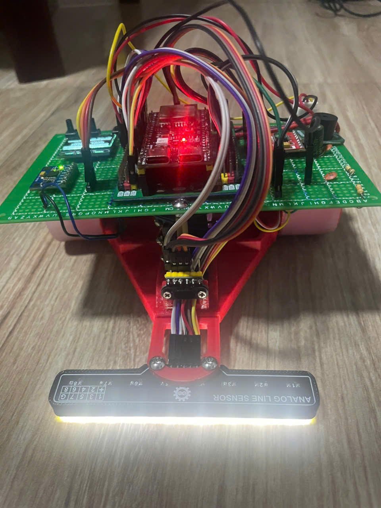
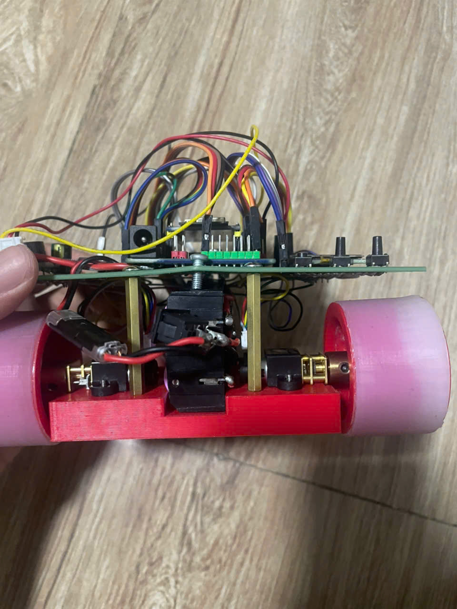
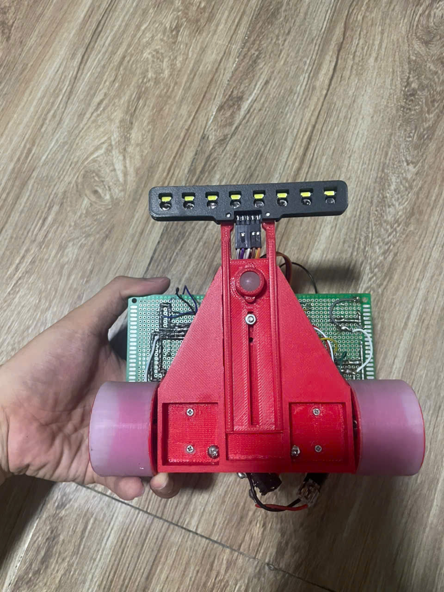
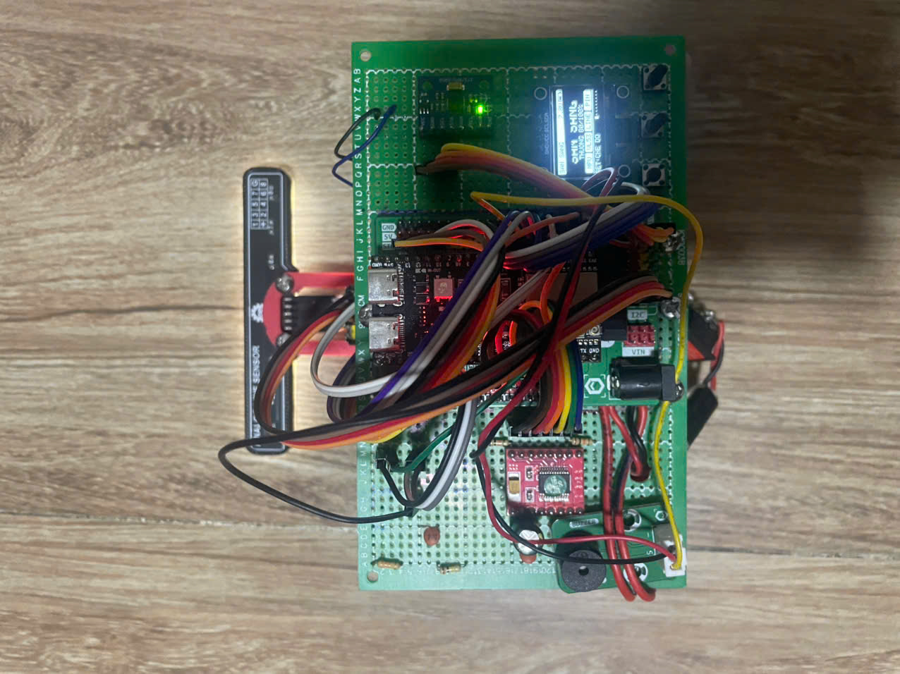

# Line Follower Robot

**English** | [Tiếng Việt](vn.md)

[](https://github.com/Ygbzyem/Robot-Line-Follower-Obstacles-Detector/actions/workflows/build.yml)


High-speed line-following robot with obstacle avoidance on ESP32-S3, built for the F-Chip line-maze contest.



## Features

- 8-channel analog line sensing with per-channel calibration, sensor-lag compensation and stuck-channel rejection
- Junction and cluster handling (square and hexagon grids), 90° corners, zigzags, dashed lines and arcs
- Per-wheel speed control from quadrature encoders, gyro heading from an MPU6050
- Obstacle avoidance around a brick detected by a front VL53L0X, then line re-acquisition
- DEMO run that records the track map and FAST run that replays it
- Tuning through an OLED menu, Serial commands or a Wi-Fi page; all values stored in NVS

## Repository Structure

```
line-follower-robot/
├── README.md                              # English
├── vn.md                                  # Vietnamese
├── LICENSE
├── CONTRIBUTING.md
├── CHANGELOG.md
├── .gitignore
├── .editorconfig
├── platformio.ini                         # builds src/competition by default
│
├── .github/
│   ├── ISSUE_TEMPLATE/
│   │   ├── bug_report.md
│   │   ├── feature_request.md
│   │   └── hardware_issue.md
│   ├── workflows/
│   │   └── build.yml                      # compiles every sketch on each push
│   └── PULL_REQUEST_TEMPLATE.md
│
├── src/
│   ├── README.md                          # what each folder contains
│   ├── competition/                       # RUNNING on the robot
│   │   └── Robot_Competition/             # contest firmware C3.11b
│   │
│   ├── archive/                           # earlier contest versions, not flashed any more
│   │   ├── Robot_Competition_v31/         # v3.1   DEMO / FAST map modes
│   │   ├── Robot_Competition_C39/         # C3.9   circle-cluster exit, anti-stall pivot
│   │   ├── Robot_Competition_A/           # v3.5.1 wheel speed PID, flowing avoidance
│   │   ├── Robot_Competition_B/           # v3.9.1 parallel version B
│   │   └── Robot_Competition_C/           # v3.8   version C, wrong-way guard
│   │
│   ├── prototypes/                        # development firmware before the contest code
│   │   ├── Robot_Skeleton_v02/
│   │   ├── Robot_MKE_v03/
│   │   ├── Robot_LineFollow_v5/
│   │   └── Robot_RouteRun/
│   │
│   └── tests/                             # bring-up sketches, not used in a run
│       ├── hardware/                      # one peripheral or behavior per sketch
│       │   ├── Test_Power/             Test_Buttons/       Test_OLED/
│       │   ├── Test_MPU_OLED_Buttons/  Test_TB6612/        Test_RightMotor/
│       │   ├── Test_N20/               Test_FullSpeed10s/  Test_LineSensor/
│       │   └── Test_DriveStraight_Simple/  Test_DriveStraight/
│       └── integration/                   # several modules or the whole robot
│           ├── Test_Integration/
│           └── Test_FullRobot/
│
├── docs/
│   ├── architecture/
│   │   └── system_architecture.md         # block diagram, firmware structure, data flow
│   ├── hardware/
│   │   ├── components.md                  # parts, prices, shops
│   │   └── pinout.md
│   └── testing/
│       └── test_plan.md                   # bring-up order and pass criteria
│
├── hardware/
│   └── schematics/
│
└── media/
    ├── photos/
    └── videos/
```

Each sketch sits in a folder with the same name (`Robot_Competition/Robot_Competition.ino`), so it opens directly in the Arduino IDE. See [src/README.md](src/README.md) for what every folder and sketch does.

## Hardware

ESP32-S3 (MakerEDU MKE-K01 + MKE-B01 shield), 2 × N20 encoder motors on a TB6612FNG, 8-channel analog line sensor, VL53L0X, MPU6050, SSD1306 OLED, 3 buttons, buzzer, 2S 18650 battery.

- Parts, prices and shops: [docs/hardware/components.md](docs/hardware/components.md)
- Pin mapping: [docs/hardware/pinout.md](docs/hardware/pinout.md)
- Wiring diagram: [hardware/schematics/](hardware/schematics/)
- System overview: [docs/architecture/system_architecture.md](docs/architecture/system_architecture.md)

## Mechanical Build

The robot has two layers: a 3D-printed base (layer 1) that carries the motors, the battery and the line sensor, and a perfboard (layer 2) that carries the electronics, held above the base on brass standoffs.

| Front | Rear | Bottom |
|---|---|---|
|  |  |  |

### Layer 1: base and battery

The base is a 3D model the team bought and had made to order by the Shopee shop [Xe Dò Line](https://shopee.vn/xedoline). The photoresistor line sensor on this robot comes from the same shop. You can order from it or design your own base.

Layer 1 holds:

- the two N20 encoder motors and the wheels,
- the front arm that keeps the line sensor at a fixed height above the track,
- the battery pack, low and between the drive wheels,
- the brass standoffs that carry layer 2.

The battery pack is two 18650 cells in series (2S: 7.4 V nominal, 8.4 V full) with a protection board soldered on. This pack is the author's own design. Power the robot however you prefer; you do not have to copy it.

**Benefits**

- The pack voltage is above what the motors need, so the TB6612 can keep the target wheel speed while the pack drains instead of slowing down.
- 18650 cells supply the motor start and stall currents without a large voltage drop, and 2600 mAh lasts many practice runs per charge.
- The protection board cuts the output on overcharge, over-discharge and short circuit, which protects both the cells and the wiring.
- Soldered joints do not lose contact when the robot bumps or vibrates, unlike the springs of a cell holder, so the ESP32-S3 does not reset in the middle of a run.
- The heaviest part sits low and between the drive wheels: a low center of gravity, more grip on the drive wheels and steadier fast turns.
- The cells are cheap and easy to find, and the pack is shaped to fit the base.

**Limitations**

- Cells cannot be swapped between runs; the pack is charged as a whole with a 2S (8.4 V) charger.
- Most simple protection boards do not balance the cells. Check each cell voltage from time to time and charge them separately if they drift apart.
- The protection board has a current limit. A stalled motor or a hard reversal can trip it and cut the power during a run, so pick a board rated well above the stall current of both motors together.
- There is no fuse: the protection board is the only short-circuit protection, so keep the power wiring short, insulated and tidy.
- Heat from soldering can damage an 18650 cell. Spot-welded nickel strips or cells with solder tabs are safer.
- Two 18650 cells weigh about 90 g, a large share of a small robot, which adds inertia in turns and braking.
- The voltage falls from 8.4 V to about 6.5 V over one charge, so the same PWM gives a different speed. Tune at a mid charge level and recheck when the pack is full or low.
- 8.4 V is above the 6 V rating of the N20 motors; long runs at full PWM wear them faster and heat them up.
- Replacing a worn cell means taking the pack apart. A damaged Li-ion pack is a fire risk: do not charge it unattended and do not use a dented cell.

### Layer 2: electronics



The electronics are soldered on a perfboard. We chose perfboard because a mistake can be fixed by desoldering a joint and rerouting a wire, without making a new board. If you prefer a PCB, you can make one from the author's schematic in [hardware/schematics/](hardware/schematics/). The schematic does not include the IO shield of the ESP32-S3.

| Part | Role |
|---|---|
| ESP32-S3 (MKE-K01) | Main controller: reads the sensors, runs line following, junction handling and obstacle avoidance, drives the motors, serves the Wi-Fi tuning page |
| IO shield (MKE-B01) | Holds the ESP32-S3 and brings every GPIO out to pin headers, so the modules plug in with jumper wires |
| TB6612FNG | Dual H-bridge: turns the PWM and direction signals of the ESP32-S3 into motor current from the battery |
| 470 µF capacitor | Absorbs motor current spikes on the TB6612 supply so the voltage does not dip and reset the ESP32-S3 |
| Quick wire connector (2-wire, 22–20 AWG) | Joins the battery leads to layer 2 without soldering, so the pack can be unplugged for charging or replacement |
| 100 kΩ + 33 kΩ divider | Scales the battery voltage down for GPIO4 so the firmware can read it |
| MPU6050 | Gyroscope: holds the heading on straights and in the hexagon section, measures the turn angles of obstacle avoidance |
| OLED SSD1306 | Shows the menu pages, sensor status, battery voltage and run results |
| Buttons START / SET / MODE | Start a run, run the action of the current page, go to the next page; any button stops the robot |
| Buzzer | Beeps at start, at track events and on warnings |
| Headers and wires | Connect the line sensor, the VL53L0X and the motors and encoders on layer 1 |

The line sensor (front arm), the VL53L0X (front, facing forward) and the motors with their encoders are not on layer 2.

## Getting Started

### Build and flash

Install VS Code with the **PlatformIO IDE** extension (or the PlatformIO CLI), connect the robot over USB, then:

```sh
pio run -t upload          # build and flash src/competition/Robot_Competition
pio device monitor         # Serial 115200
```

With the Arduino IDE (esp32 core 3.0.7, board **ESP32S3 Dev Module**), open `src/competition/Robot_Competition/Robot_Competition.ino` and install the four libraries from the Library Manager.

Libraries (Adafruit_VL53L0X, Adafruit GFX, Adafruit SSD1306, Pololu VL53L0X) are installed automatically from `platformio.ini`.

### First run

1. Power on with the wheels lifted. The Serial banner prints the battery voltage and `MPU OK`, `VL53 OK`.
2. `cal` calibrates the line sensor, `raw` checks that all 8 channels change between black and white.
3. `wcal` measures the wheel speed at 100 % for the speed control.
4. Start with `sp 30` and `vmax 30`, then raise the speed step by step.

## Testing

Bring-up sketches are in `src/tests/`. Follow the order and pass criteria in [docs/testing/test_plan.md](docs/testing/test_plan.md). Flash a test with:

```sh
PLATFORMIO_SRC_DIR=src/tests/hardware/Test_LineSensor pio run -t upload
```

On PowerShell: `$env:PLATFORMIO_SRC_DIR="src/tests/hardware/Test_LineSensor"; pio run -t upload`, then `Remove-Item Env:PLATFORMIO_SRC_DIR`.

## Tuning

- **OLED + buttons**: MODE = next page, SET = page action, START = run, any button = stop.
- **Serial 115200 (Newline)**: `kp 14`, `kd 0.35`, `sp 40`, `vmax 60`, `obs 130`; several at once: `kp 12;kd 0.4;sp 70`. `export` prints every parameter in one line that can be pasted back.
- **Wi-Fi page**: when idle the robot opens the access point `LINE-ROBOT`; browse to `192.168.4.1` for results, event log, parameter editing and `log.txt`.

Command names of earlier builds are still accepted, so exported parameter lines from those builds load unchanged.

## Known Issues

`Robot_Skeleton_v02` and `Robot_MKE_v03` do not compile because `typedef StopFn` and `struct Btn` are declared after the first function. They are kept unchanged in `src/prototypes/` as history and are skipped by the CI build.

## Version History

The robot runs `src/competition/Robot_Competition` (C3.11b). Earlier contest versions are kept in `src/archive/`; see [CHANGELOG.md](CHANGELOG.md).

| Version | Folder | Summary |
|---|---|---|
| C3.11b | `src/competition/Robot_Competition` | Latest contest firmware: hexagon-cluster heading lock, straight start out of the black box |
| C3.9 | `src/archive/Robot_Competition_C39` | Circle-cluster exit, avoidance toward the bend, anti-stall pivot |
| v3.9.1 | `src/archive/Robot_Competition_B` | Parallel version B |
| v3.8 | `src/archive/Robot_Competition_C` | Version C with wrong-way guard |
| v3.5.1 | `src/archive/Robot_Competition_A` | Wheel speed PID, flowing avoidance |
| v3.1 | `src/archive/Robot_Competition_v31` | DEMO / FAST map modes |

## Contributing

See [CONTRIBUTING.md](CONTRIBUTING.md).

## Author

**Phạm Minh Tùng** — Semiconductor IC Design, FPT University.
## License

[MIT](LICENSE) © 2026 Phạm Minh Tùng
