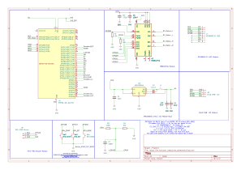
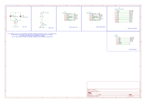

# Schematics

**English** | [Tiếng Việt](vn.md)

Wiring diagram of the robot, drawn in KiCad 10 as a hierarchical schematic. The root sheet is layer 2 (the perfboard) and holds the `Floor1` sub-sheet for layer 1 (the 3D-printed base).

| File | Content |
|---|---|
| `schematic.pdf` | Both sheets in one file: page 1 layer 2, page 2 layer 1 |
| `schematic_floor2.svg` | Layer 2: ESP32-S3, TB6612FNG, MPU6050, OLED, buttons, buzzer, battery divider, optional 5 V buck |
| `schematic_floor1.svg` | Layer 1: 2S battery, quick connector and switch, motor and encoder connectors, line sensor, VL53L0X |
| `robot_line_follower_obstacles_detected.kicad_pro` | KiCad project |
| `robot_line_follower_obstacles_detected.kicad_sch` | Root sheet (layer 2) |
| `floor1.kicad_sch` | Sub-sheet (layer 1) |

Open the `.kicad_pro` file in KiCad to edit the schematic or to start a PCB from it.

### Layer 2

### Layer 1

The schematic does not include the IO shield of the ESP32-S3 (MKE-B01).

## Optional 5 V buck converter

The author's robot powers the ESP32-S3 through the MKE-B01 IO shield, which steps the battery voltage down for the board. If you cannot buy that shield, build this buck converter instead. It turns the 2S battery (6.4–8.4 V) into 5 V for the `5V` pin of the ESP32-S3 dev board, and the regulator on the dev board then makes 3.3 V.

| Ref | Part | Connection |
|---|---|---|
| U1 | AP63205WU-7: synchronous buck, fixed 5 V out, 2 A, input 3.8–32 V, TSOT26 | |
| C1 | 10 µF | Input, VIN to GND, close to pin 3 |
| C3 | 100 nF | Bootstrap, between SW (pin 5) and BST (pin 6) |
| L1 | 4.7 µH, rated ≥ 2.7 A, DC resistance < 100 mΩ | SW (pin 5) to the 5 V output |
| C2 | 2 × 22 µF | Output, 5 V to GND |
| EN | pin 2 | Tied to VIN: starts when the battery is connected |
| FB | pin 1 | Tied to the 5 V output |

Values follow the typical application circuit in the [AP63205 datasheet](https://www.diodes.com/part/view/AP63205).

- Motor power (TB6612 VM) comes straight from the battery, not from this buck.
- Do not plug in USB while the battery powers the board unless the dev board has a diode between USB 5 V and the `5V` pin.
- Keep the VIN, GND and SW loop short, with C1 and C2 next to U1.
