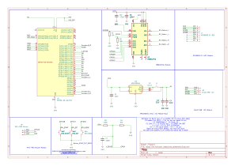
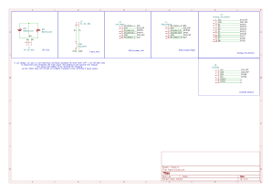

# Sơ đồ mạch

[English](README.md) | **Tiếng Việt**

Sơ đồ đấu dây của robot, vẽ bằng KiCad 10 dạng schematic phân cấp (hierarchical). Trang gốc là tầng 2 (mạch phíp) và chứa trang con `Floor1` cho tầng 1 (đế in 3D).

| File | Nội dung |
|---|---|
| `schematic.pdf` | Cả hai trang trong một file: trang 1 là tầng 2, trang 2 là tầng 1 |
| `schematic_floor2.svg` | Tầng 2: ESP32-S3, TB6612FNG, MPU6050, OLED, nút nhấn, còi, cầu chia áp đo pin, mạch hạ áp 5 V tuỳ chọn |
| `schematic_floor1.svg` | Tầng 1: pin 2S, đầu nối nhanh và công tắc, đầu nối motor và encoder, cảm biến line, VL53L0X |
| `robot_line_follower_obstacles_detected.kicad_pro` | Project KiCad |
| `robot_line_follower_obstacles_detected.kicad_sch` | Trang gốc (tầng 2) |
| `floor1.kicad_sch` | Trang con (tầng 1) |

Mở file `.kicad_pro` bằng KiCad để sửa schematic hoặc dùng làm điểm bắt đầu vẽ PCB.

### Tầng 2

### Tầng 1

Schematic không bao gồm IO shield của ESP32-S3 (MKE-B01).

## Mạch hạ áp 5 V (tuỳ chọn)

Xe của tác giả cấp nguồn cho ESP32-S3 qua IO shield MKE-B01, shield này tự hạ áp pin xuống cho board. Nếu không mua được shield, hãy làm mạch hạ áp này thay thế. Mạch hạ pin 2S (6,4–8,4 V) xuống 5 V cấp vào chân `5V` của board ESP32-S3, sau đó mạch ổn áp có sẵn trên board hạ tiếp xuống 3,3 V.

| Ký hiệu | Linh kiện | Cách nối |
|---|---|---|
| U1 | AP63205WU-7: buck đồng bộ, ra cố định 5 V, 2 A, áp vào 3,8–32 V, gói TSOT26 | |
| C1 | 10 µF | Tụ đầu vào, VIN xuống GND, đặt sát chân 3 |
| C3 | 100 nF | Tụ bootstrap, nối giữa SW (chân 5) và BST (chân 6) |
| L1 | 4,7 µH, dòng định mức ≥ 2,7 A, điện trở DC < 100 mΩ | Từ SW (chân 5) ra ngõ ra 5 V |
| C2 | 2 × 22 µF | Tụ đầu ra, 5 V xuống GND |
| EN | chân 2 | Nối VIN: tự chạy khi cắm pin |
| FB | chân 1 | Nối vào ngõ ra 5 V |

Giá trị linh kiện theo mạch ứng dụng mẫu trong [datasheet AP63205](https://www.diodes.com/part/view/AP63205).

- Nguồn motor (VM của TB6612) lấy thẳng từ pin, không đi qua mạch này.
- Không cắm USB khi pin đang cấp nguồn, trừ khi board có diode giữa 5 V của USB và chân `5V`.
- Đi dây vòng VIN, GND, SW thật ngắn, đặt C1 và C2 sát U1.
