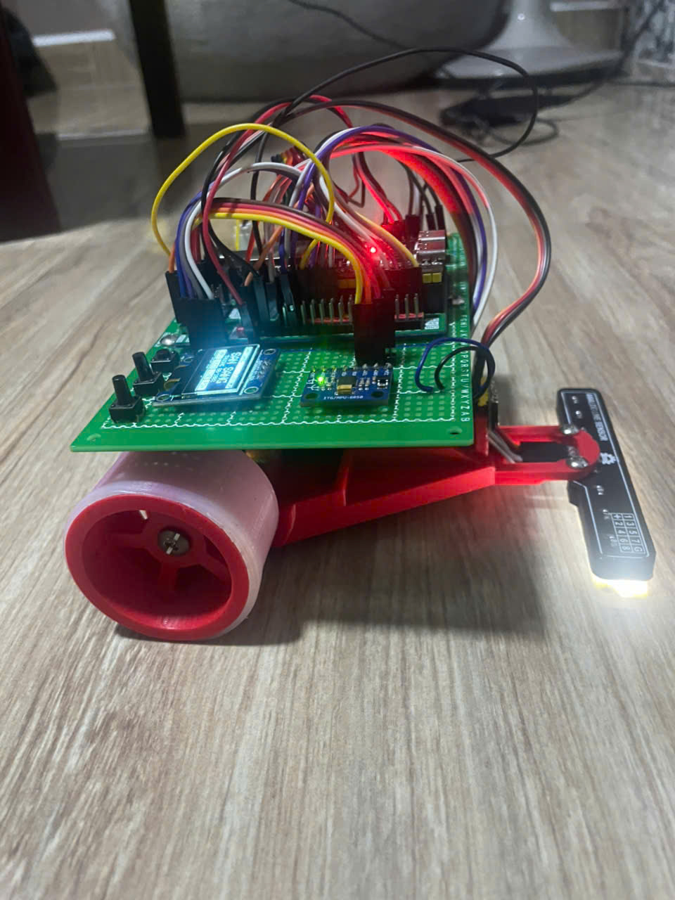
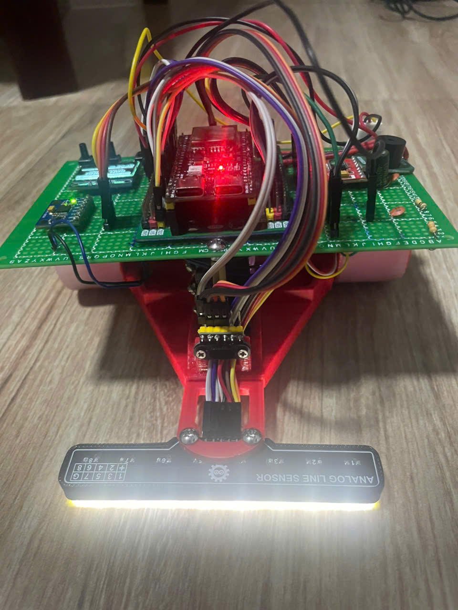
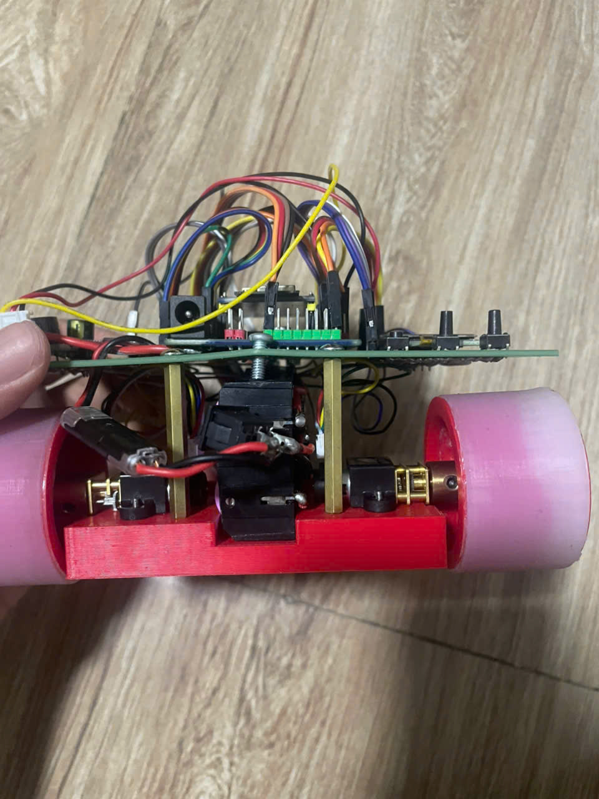
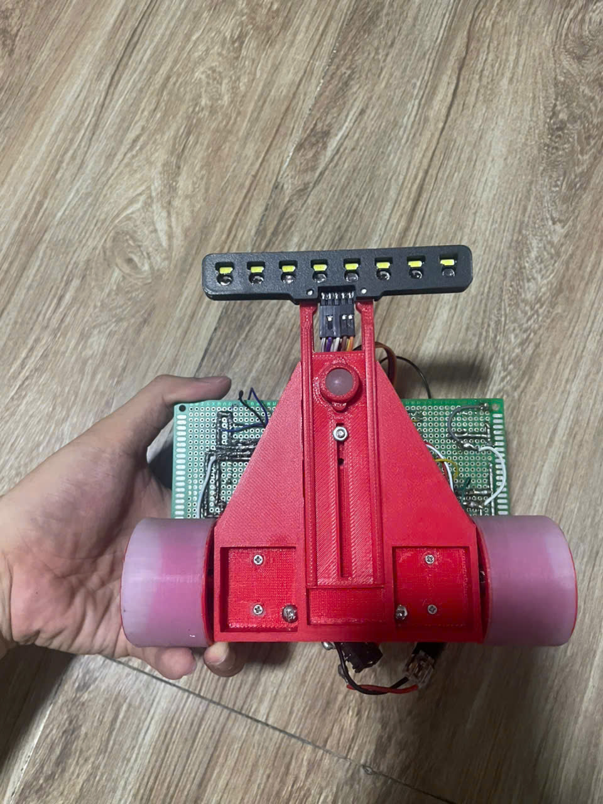
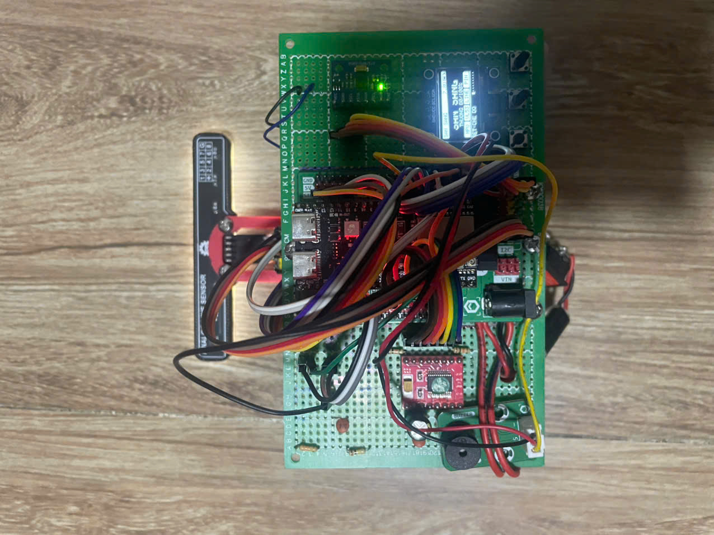

# Robot Dò Line

[English](README.md) | **Tiếng Việt**

[](https://github.com/Ygbzyem/Robot-Line-Follower-Obstacles-Detector/actions/workflows/build.yml)


Robot dò line tốc độ cao có né vật cản trên ESP32-S3, làm cho cuộc thi robot dò line mê cung của F-Chip.



## Tính năng

- Cảm biến line analog 8 mắt, hiệu chuẩn riêng từng mắt, bù trễ cảm biến và tự bỏ qua mắt bị kẹt
- Xử lý cụm ngã rẽ (lưới ô vuông và lục giác), góc 90°, zigzag, line đứt và cung tròn
- Điều khiển tốc độ từng bánh bằng encoder, giữ hướng bằng gyro MPU6050
- Né viên gạch phát hiện bằng VL53L0X phía trước rồi bắt lại line
- Lượt DEMO ghi bản đồ sa bàn, lượt FAST chạy lại theo bản đồ
- Chỉnh thông số qua menu OLED, lệnh Serial hoặc trang Wi-Fi; mọi giá trị lưu trong NVS

## Cấu trúc repo

```
line-follower-robot/
├── README.md                              # tiếng Anh
├── vn.md                                  # tiếng Việt
├── LICENSE
├── CONTRIBUTING.md
├── CHANGELOG.md
├── .gitignore
├── .editorconfig
├── platformio.ini                         # mặc định build src/competition
│
├── .github/
│   ├── ISSUE_TEMPLATE/
│   │   ├── bug_report.md
│   │   ├── feature_request.md
│   │   └── hardware_issue.md
│   ├── workflows/
│   │   └── build.yml                      # tự biên dịch mọi sketch mỗi lần push
│   └── PULL_REQUEST_TEMPLATE.md
│
├── src/
│   ├── README.md                          # giải thích từng thư mục
│   ├── competition/                       # code ĐANG CHẠY trên xe
│   │   └── Robot_Competition/             # firmware thi đấu C3.13
│   │
│   ├── archive/                           # các bản thi đấu cũ, không nạp nữa
│   │   ├── Robot_Competition_v31/         # v3.1   chế độ DEMO / FAST theo bản đồ
│   │   ├── Robot_Competition_C311b/       # C3.11b bản tốt nhất cho motor 500 rpm
│   │   ├── Robot_Competition_C39/         # C3.9   thoát cụm vòng tròn, chống kẹt khi xoay
│   │   ├── Robot_Competition_A/           # v3.5.1 PID tốc độ bánh, né lướt
│   │   ├── Robot_Competition_B/           # v3.9.1 bản B chạy song song
│   │   └── Robot_Competition_C/           # v3.8   bản C, chống chạy ngược
│   │
│   ├── prototypes/                        # firmware phát triển trước code thi đấu
│   │   ├── Robot_Skeleton_v02/
│   │   ├── Robot_MKE_v03/
│   │   ├── Robot_LineFollow_v5/
│   │   └── Robot_RouteRun/
│   │
│   └── tests/                             # sketch kiểm tra phần cứng, không dùng khi chạy
│       ├── hardware/                      # mỗi sketch kiểm tra một linh kiện hoặc một hành vi
│       │   ├── Test_Power/             Test_Buttons/       Test_OLED/
│       │   ├── Test_MPU_OLED_Buttons/  Test_TB6612/        Test_RightMotor/
│       │   ├── Test_N20/               Test_FullSpeed10s/  Test_LineSensor/
│       │   └── Test_DriveStraight_Simple/  Test_DriveStraight/
│       └── integration/                   # nhiều module cùng lúc hoặc cả xe
│           ├── Test_Integration/
│           └── Test_FullRobot/
│
├── docs/
│   ├── architecture/
│   │   └── system_architecture.md         # sơ đồ khối, cấu trúc firmware, luồng dữ liệu
│   ├── hardware/
│   │   ├── components.md                  # linh kiện, giá, nơi mua
│   │   └── pinout.md
│   ├── testing/
│   │   └── test_plan.md                   # thứ tự kiểm tra và tiêu chí đạt
│   └── tuning/
│       └── README.md                      # từng lệnh chỉnh thông số, giá trị và khi nào chỉnh
│
├── hardware/
│   └── schematics/
│
└── media/
    ├── photos/
    └── videos/
```

Mỗi sketch nằm trong thư mục cùng tên (`Robot_Competition/Robot_Competition.ino`) nên mở thẳng được bằng Arduino IDE. Xem [src/README.md](src/README.md) để biết từng thư mục và từng sketch dùng làm gì (tài liệu tiếng Anh).

## Phần cứng

ESP32-S3 (MakerEDU MKE-K01 + shield MKE-B01), 2 motor N20 có encoder qua driver TB6612FNG, cảm biến line analog 8 mắt, VL53L0X, MPU6050, OLED SSD1306, 3 nút nhấn, còi, pin 2S 18650.

- Linh kiện, giá, nơi mua: [docs/hardware/components.md](docs/hardware/components.md)
- Sơ đồ chân: [docs/hardware/pinout.md](docs/hardware/pinout.md)
- Sơ đồ đấu dây: [hardware/schematics/](hardware/schematics/)
- Tổng quan hệ thống: [docs/architecture/system_architecture.md](docs/architecture/system_architecture.md)

Các tài liệu trong `docs/` viết bằng tiếng Anh.

## Lắp ráp cơ khí

Xe gồm hai tầng: tầng 1 là đế in 3D mang motor, pin và cảm biến line; tầng 2 là mạch phíp mang phần điện tử, đặt phía trên đế bằng các trụ đồng.

| Mặt trước | Mặt sau | Mặt dưới |
|---|---|---|
|  |  |  |

### Tầng 1: đế xe và pin

Đế xe là mô hình 3D nhóm mua riêng và đặt gia công theo yêu cầu qua shop Shopee [Xe Dò Line](https://shopee.vn/xedoline). Cảm biến dò line loại quang trở trên xe cũng mua ở shop này. Các bạn có thể tham khảo shop hoặc tự thiết kế đế.

Tầng 1 gồm:

- hai motor N20 có encoder và bánh xe,
- tay đỡ phía trước giữ cảm biến line ở độ cao cố định so với sa bàn,
- khối pin, đặt thấp và nằm giữa hai bánh chủ động,
- các trụ đồng đỡ tầng 2.

Khối pin gồm hai pin 18650 nối tiếp (2S: danh định 7,4 V, đầy 8,4 V) có hàn mạch bảo vệ pin. Khối pin này làm theo ý của tác giả. Các bạn có thể tự chế tạo nguồn cấp cho xe theo cách của mình, không bắt buộc làm theo.

**Lợi ích**

- Điện áp pin cao hơn mức motor cần, nên TB6612 vẫn giữ được tốc độ bánh đặt khi pin yếu dần thay vì xe chạy chậm lại.
- Pin 18650 cấp đủ dòng khởi động và dòng kẹt motor mà không sụt áp nhiều, dung lượng 2600 mAh chạy tập được nhiều lượt mỗi lần sạc.
- Mạch bảo vệ ngắt nguồn khi sạc quá, xả quá hoặc chập mạch, bảo vệ cả pin lẫn dây dẫn.
- Mối hàn không bị mất tiếp xúc khi xe va chạm hay rung, khác với lò xo của đế pin, nên ESP32-S3 không bị khởi động lại giữa lượt chạy.
- Phần nặng nhất nằm thấp và giữa hai bánh chủ động: trọng tâm thấp, bánh bám đường hơn và ổn định hơn khi vào cua nhanh.
- Pin rẻ, dễ mua, khối pin làm vừa với đế.

**Hạn chế**

- Không thay pin nhanh giữa các lượt được; cả khối pin phải sạc bằng bộ sạc 2S (8,4 V).
- Phần lớn mạch bảo vệ đơn giản không cân bằng cell. Thỉnh thoảng nên đo điện áp từng cell và sạc riêng nếu hai cell lệch nhau.
- Mạch bảo vệ có giới hạn dòng. Motor bị kẹt hoặc đảo chiều gấp có thể làm mạch ngắt nguồn giữa lượt chạy, nên chọn mạch có dòng định mức cao hơn hẳn dòng kẹt của cả hai motor.
- Xe không dùng cầu chì: mạch bảo vệ pin là lớp bảo vệ chập mạch duy nhất, nên đi dây nguồn ngắn, bọc cách điện và gọn gàng.
- Nhiệt khi hàn có thể làm hỏng pin 18650. Hàn bấm lá kẽm (niken) hoặc dùng pin có sẵn chân hàn sẽ an toàn hơn.
- Hai pin 18650 nặng khoảng 90 g, chiếm phần lớn khối lượng của một xe nhỏ, làm tăng quán tính khi vào cua và khi phanh.
- Điện áp giảm từ 8,4 V xuống khoảng 6,5 V trong một lần sạc, nên cùng một mức PWM cho tốc độ khác nhau. Nên chỉnh thông số khi pin ở mức giữa và kiểm tra lại khi pin đầy hoặc yếu.
- 8,4 V cao hơn mức 6 V định mức của motor N20; chạy lâu ở PWM tối đa làm motor nóng và nhanh mòn.
- Thay một cell bị chai phải tháo cả khối pin. Pin Li-ion bị hư có nguy cơ cháy: không sạc khi không có người trông và không dùng pin bị móp.

### Tầng 2: mạch điện tử



Phần điện tử được hàn trên mạch phíp. Nhóm chọn hàn phíp để nếu có sai sót thì có thể rã mối hàn và đi lại dây, không phải làm mạch mới. Nếu muốn dùng PCB, các bạn có thể làm dựa trên schematic tác giả vẽ trong [hardware/schematics/](hardware/schematics/). Schematic không bao gồm IO shield của ESP32-S3.

| Linh kiện | Vai trò |
|---|---|
| ESP32-S3 (MKE-K01) | Bộ điều khiển chính: đọc cảm biến, chạy dò line, xử lý ngã rẽ và né vật cản, điều khiển motor, phát trang chỉnh thông số qua Wi-Fi |
| IO shield (MKE-B01) | Gắn ESP32-S3 và đưa mọi chân GPIO ra hàng rào, nên các module cắm vào bằng dây jumper |
| TB6612FNG | Mạch cầu H đôi: biến tín hiệu PWM và chiều quay từ ESP32-S3 thành dòng điện từ pin cấp cho motor |
| Tụ 470 µF | Hấp thụ xung dòng của motor ở nguồn TB6612 để điện áp không sụt làm ESP32-S3 khởi động lại |
| Đầu nối nhanh dây điện (2 dây, 22–20 AWG) | Nối dây pin vào tầng 2 mà không cần hàn, nên rút pin ra để sạc hoặc thay được |
| Cầu chia áp 100 kΩ + 33 kΩ | Hạ điện áp pin xuống mức GPIO4 đọc được để firmware đo điện áp pin |
| MPU6050 | Con quay hồi chuyển: giữ hướng trên đoạn thẳng và trong cụm lục giác, đo góc quay khi né vật cản |
| OLED SSD1306 | Hiện các trang menu, trạng thái cảm biến, điện áp pin và kết quả lượt chạy |
| Nút START / SET / MODE | Bắt đầu chạy, thực hiện thao tác của trang hiện tại, sang trang kế; nút bất kỳ để dừng xe |
| Còi | Kêu khi bắt đầu chạy, khi gặp sự kiện trên sa bàn và khi có cảnh báo |
| Hàng rào và dây nối | Nối cảm biến line, VL53L0X, motor và encoder ở tầng 1 |

Cảm biến line (tay đỡ phía trước), VL53L0X (phía trước, nhìn thẳng) và motor cùng encoder không nằm ở tầng 2.

## Bắt đầu

### Biên dịch và nạp

Cài VS Code với extension **PlatformIO IDE** (hoặc PlatformIO CLI), cắm xe qua USB rồi chạy:

```sh
pio run -t upload          # biên dịch và nạp src/competition/Robot_Competition
pio device monitor         # Serial 115200
```

Nếu dùng Arduino IDE (core esp32 3.0.7, board **ESP32S3 Dev Module**), mở `src/competition/Robot_Competition/Robot_Competition.ino` và cài bốn thư viện bằng Library Manager.

Các thư viện (Adafruit_VL53L0X, Adafruit GFX, Adafruit SSD1306, Pololu VL53L0X) được PlatformIO tự cài theo `platformio.ini`.

### Lần chạy đầu

1. Bật nguồn khi bánh đang nhấc lên. Serial in ra điện áp pin và `MPU OK`, `VL53 OK`.
2. Lệnh `cal` hiệu chuẩn cảm biến line, lệnh `raw` kiểm tra cả 8 mắt đều thay đổi giữa đen và trắng.
3. Lệnh `wcal` đo tốc độ bánh ở 100 % cho bộ điều khiển tốc độ.
4. Chạy thử với `sp 30` và `vmax 30`, sau đó tăng dần tốc độ.

## Kiểm tra phần cứng

Các sketch kiểm tra nằm trong `src/tests/`. Làm theo thứ tự và tiêu chí đạt trong [docs/testing/test_plan.md](docs/testing/test_plan.md). Nạp một sketch test bằng:

```sh
PLATFORMIO_SRC_DIR=src/tests/hardware/Test_LineSensor pio run -t upload
```

Trên PowerShell: `$env:PLATFORMIO_SRC_DIR="src/tests/hardware/Test_LineSensor"; pio run -t upload`, sau đó `Remove-Item Env:PLATFORMIO_SRC_DIR`.

## Chỉnh thông số

- **OLED + nút**: MODE = sang trang, SET = thao tác của trang, START = chạy, nút bất kỳ = dừng.
- **Serial 115200 (Newline)**: `kp 14`, `kd 0.35`, `sp 40`, `vmax 60`, `obs 130`; nhiều lệnh một lúc: `kp 12;kd 0.4;sp 70`. Lệnh `export` in toàn bộ thông số thành một dòng, dán lại dòng đó là nạp lại được.
- **Trang Wi-Fi**: khi đứng yên xe phát Wi-Fi `LINE-ROBOT`; vào `192.168.4.1` để xem kết quả, nhật ký sự kiện, sửa thông số và tải `log.txt`.

Firmware vẫn nhận tên lệnh của các bản trước, nên dòng thông số xuất từ bản cũ vẫn nạp được.

Giải thích từng lệnh, giá trị hiện tại và khi nào nên chỉnh: [docs/tuning/vn.md](docs/tuning/vn.md).

## Lỗi đã biết

`Robot_Skeleton_v02` và `Robot_MKE_v03` không biên dịch được vì `typedef StopFn` và `struct Btn` được khai báo sau hàm đầu tiên. Hai bản này được giữ nguyên trong `src/prototypes/` làm lịch sử và được bỏ qua khi CI biên dịch.

## Lịch sử phiên bản

Xe đang chạy `src/competition/Robot_Competition` (C3.13). Các bản thi đấu cũ nằm trong `src/archive/`; xem chi tiết ở [CHANGELOG.md](CHANGELOG.md).

| Phiên bản | Thư mục | Tóm tắt |
|---|---|---|
| C3.13 | `src/competition/Robot_Competition` | Firmware thi đấu mới nhất: C3.11b với thông số mặc định cho motor mới (hộp số ~20,7:1) |
| C3.11b | `src/archive/Robot_Competition_C311b` | Bản tốt nhất cho motor 500 rpm: khoá hướng trong cụm lục giác, xuất phát đi thẳng ra khỏi ô đen |
| C3.9 | `src/archive/Robot_Competition_C39` | Thoát cụm vòng tròn, né về phía cua, chống kẹt khi xoay |
| v3.9.1 | `src/archive/Robot_Competition_B` | Bản B chạy song song |
| v3.8 | `src/archive/Robot_Competition_C` | Bản C có chống chạy ngược |
| v3.5.1 | `src/archive/Robot_Competition_A` | PID tốc độ bánh, né lướt |
| v3.1 | `src/archive/Robot_Competition_v31` | Chế độ DEMO / FAST theo bản đồ |

## Đóng góp

Xem [CONTRIBUTING.md](CONTRIBUTING.md).

## Tác giả

**Phạm Minh Tùng** — Thiết kế vi mạch bán dẫn, Đại học FPT. [Thành viên nhóm]

## Giấy phép

[MIT](LICENSE) © 2026 Phạm Minh Tùng
